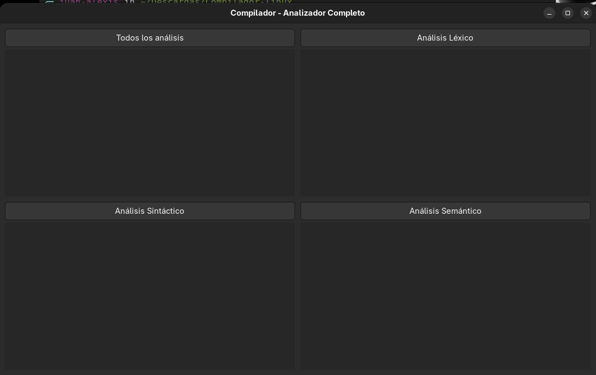
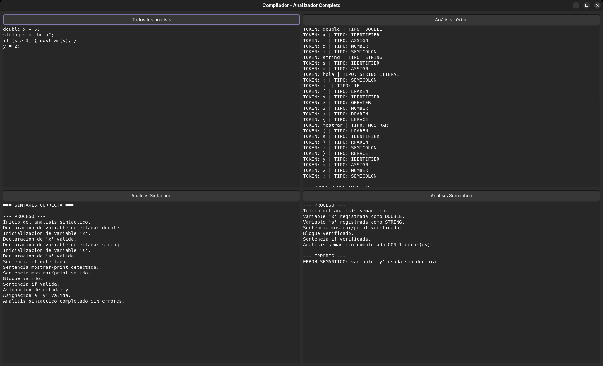
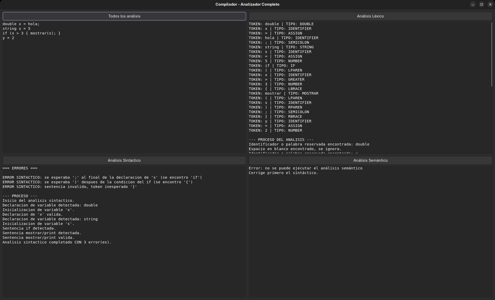

# Compilador – Analizador léxico, sintáctico y semántico

Compilador educativo para un lenguaje propio en español, con interfaz gráfica que muestra el resultado de cada fase del análisis y reporta los errores encontrados.


## Capturas del compilador

### Imagen del compilador

### Prueba con codigo corto

### Prueba de manejo de errores 


## Fases implementadas

| Fase | Archivo | Qué hace |
|---|---|---|
| **Léxica** | `Lexer.cpp` | Convierte el código fuente en tokens: palabras reservadas, identificadores, números, cadenas, caracteres, operadores y delimitadores. |
| **Sintáctica** | `Sintactico.cpp` | *Parser* descendente recursivo que valida la gramática y se recupera de errores para seguir reportando (*synchronize*). |
| **Semántica** | `Semantico.cpp` | Tabla de símbolos: detecta variables no declaradas, redeclaradas o usadas sin inicializar. |

## El lenguaje

- Tipos: `string`, `double`
- Control de flujo: `if` / `else`, `for`
- Entrada y salida: `LEER`, `MOSTRAR`
- Expresiones aritméticas y relacionales con precedencia (`+ - * / %`, `< > <= >= == !=`, `++`)
- Bloques con `{ }` y un punto de inicio `INICIO`

```
INICIO {
    double total = 0;
    for (double i = 0; i < 5; i++) {
        total = total + i;
    }
    if (total > 5) {
        MOSTRAR("Mayor a cinco");
    }
}
```

<!-- Revisa que el ejemplo coincida con la sintaxis exacta de tu lenguaje y ajústalo si hace falta. -->

## Cómo ejecutarlo

Requisitos: Windows y Visual Studio 2022 con la carga de trabajo **Desarrollo para el escritorio con C++** y el componente **Compatibilidad con C++/CLI**.

1. Abre `Compilador-Analizadores.sln`.
2. Compila en configuración **Debug x64**.
3. Ejecuta, escribe o pega código en el editor y ejecuta cada fase.

## Estructura

```
Token.h            tipos de token
Lexer.h/.cpp       analizador léxico
Sintactico.h/.cpp  analizador sintáctico (parser)
Semantico.h/.cpp   analizador semántico y tabla de símbolos
FormPrincipal.h    interfaz gráfica (Windows Forms)
main.cpp           punto de entrada
```

## Autor

**Juan Alexis Martínez Morán** – Proyecto de la materia de LCompiladores, Universidad Cuauhtémoc Querétaro
[LinkedIn](https://www.linkedin.com/in/juan-alexis-dev/) · [GitHub](https://github.com/Juan-Alexis-Dev)
